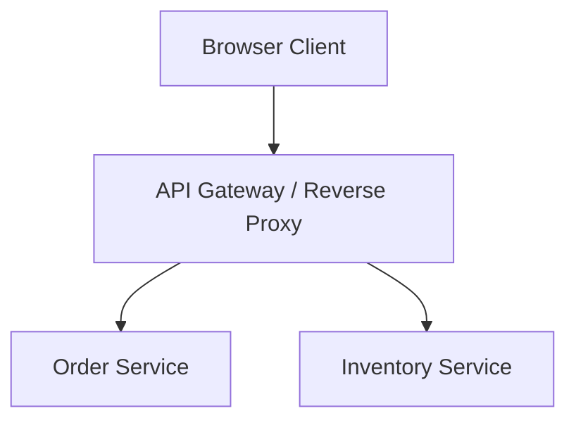
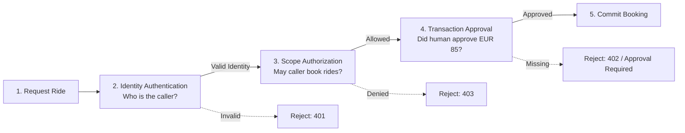
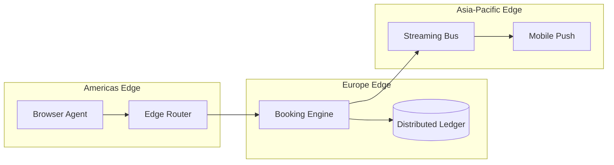
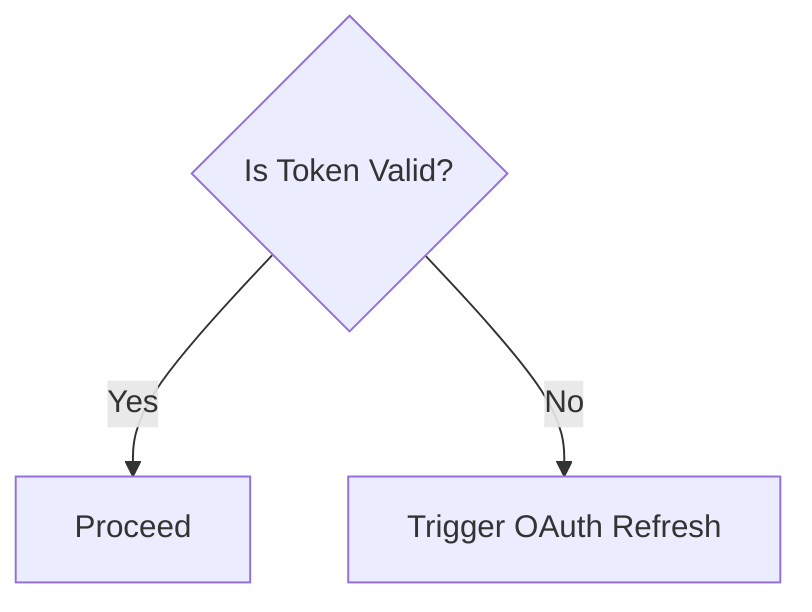
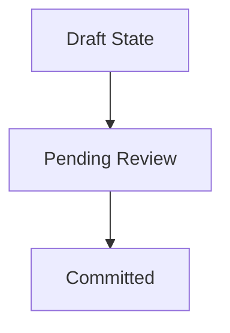

This unlisted page serves as the blog's visual proving ground and design system catalog. It exercises every layout tier, typographic rule, diagram format, table style, and figure variant in one place to inspect responsive behavior and visual rhythm at a glance.

---

## 1. Typographic Hierarchy & Inline Elements

Body copy is set in Georgia at 19px with a 1.85 line height, tuned for focused, long-form reading across both light alabaster and nocturnal bordeaux themes.

### Section Heading (Level 2)
Authored sections begin at `##` to preserve the single template-provided `<h1>` for the page title. Headings switch to the system sans-serif font with tight letter-spacing.

#### Sub-section Heading (Level 3)
Sub-sections provide clear structural rhythm without competing with primary landmarks.

Paragraphs support **bold text** (`<strong>`), *italic text* (`<em>`), inline `code blocks`, and [interactive text links](/about/) that show hover and keyboard `:focus-visible` outlines in `--accent`.

> "Containers are reserved strictly for technical enclosures and self-contained interactive tools. Typography and negative space define editorial structure naturally."
> 
> — Blog Design Principles

```javascript
// Code block preview
function calculateBreakout(viewportWidth, siteShellMax = 1088) {
  const margin = Math.max(0, (viewportWidth - siteShellMax) / 2);
  return { width: Math.min(viewportWidth - 96, siteShellMax), margin };
}
```

---

## 2. Mermaid Diagrams across all Layouts

Fenced Mermaid code blocks render to build-time SVGs with accessible role/labels, dark-mode CSS variables, and an inline Zoom modal button in the caption.

### Default Diagram (730px prose column)



### Wide Diagram (`mermaid#wide` · 1088px site shell)



### Bleed Diagram (`mermaid#bleed` · 100vw edge-to-edge)



### Narrow Diagram (`mermaid#narrow` · 380px centered)



### Floated Diagram (`mermaid#float-right` · 44% width)



When floated with `mermaid#float-right`, the diagram occupies 44% of the column width, and the following prose wraps cleanly alongside it. On mobile screens up to 760px wide, the floating rule automatically clears, returning the diagram to a full-width stacked presentation. This ensures high-density technical reading remains legible on both large desktop displays and handheld devices without horizontal layout collision.

---

## 3. Editorial Images across all Layouts

Block images are rendered as semantic `<figure class="image-figure ...">` enclosures with lazy loading and captions.

### Wide Image (`#wide`)


### Bleed Image (`#bleed` · 100vw edge-to-edge)


### Narrow Framed Image (`#narrow+frame`)


### Float Right Image (`#float-right`)


This text demonstrates prose wrapping alongside a floated image. On desktop screens, the image floats to the right with comfortable margins. On smaller viewports, the float resets to 100% full width to maintain readability.

---

## 4. Tables across all Layouts

Tables are wrapped in `<div class="table-scroll" role="region" tabindex="0">` for keyboard-accessible scrolling on mobile screens.

### Default Prose Table (2 Columns)

| Concept | Purpose |
| :--- | :--- |
| **Identity** | Establishes caller credentials (who is operating). |
| **Permissions** | Establishes general capabilities (what account can do). |
| **Consent** | Binds authorization to an immutable transaction object. |

### Wide Matrix Table (`::: wide` · 5 Columns with Legend)

::: wide

| Pattern | Who Confirms | Trust Anchor | User Friction | Best Suited For |
| :--- | :--- | :--- | :--- | :--- |
| **1. Staged Preparation** | User | Human presence (UI or Passkeys) | **Low–Medium** (1 tap at the end) | High-value, irreversible actions |
| **2. Threshold Envelopes** | Application Backend | Backend policy engine & rules | **Zero** (Interruption-free within bounds) | Frequent, routine consumer actions |
| **3. Capability Tokens** | Authorized Delegate | Authorization server (RFC 9396) | **Low** (Authorized once per session) | Cross-origin multi-service ecosystems |
| **4. Cryptographic Binding** | User or Delegate | Asymmetric cryptography | **Medium** (Signing prompt per transaction) | High-assurance finance and contracts |

*(Note: Technical authorization is often paired with operational risk backstops—such as spending velocity limits, temporary authorization holds, and automated dispute resolution.)*

:::

### Bleed Table (`::: bleed` · 100vw edge-to-edge)

::: bleed

| Protocol Tier | Primary Specification | Trust Anchor | Cryptographic Primitive | Network Transport | Failure Status | Recovery Path |
| :--- | :--- | :--- | :--- | :--- | :--- | :--- |
| **1. Session Identity** | RFC 6749 (OAuth 2.0) | Central IdP | Signed JWT (RS256) | TLS 1.3 / HTTPS | 401 Unauthorized | Silent refresh via cookie |
| **2. Capability Delegation** | RFC 9396 (OAuth RAR) | Auth Server | Rich Authorization Details | Mutual TLS | 403 Forbidden | Re-authorization challenge |
| **3. Intent Binding** | Draft WebMCP / W3C | User Private Key | Asymmetric Ed25519 | In-Browser Tool Call | 400 Invalid Signature | Prompt physical presence |
| **4. Operational Backstop** | ISO 20022 / Banking API | Backend Policy Engine | HSM Counter-signatures | Server-Sent Events | 422 Policy Exceeded | Automated velocity queue |

*(Comprehensive cross-tier protocol matrix spanning the full width of the browser window.)*

:::

### Narrow Table (`::: narrow` · 380px centered)

::: narrow

| Status | Code | Meaning |
| :---: | :---: | :--- |
| ✅ | 200 | Transaction executed |
| ⏳ | 202 | Staged for human review |
| ❌ | 403 | Policy envelope exceeded |

:::

---

## 5. Layout Containers & Future Widgets

The `::: <widget>#<layout>` syntax allows binding widgets to specific layout widths while providing semantic fallbacks.

::: rate-limiter#wide Rate Limiter Demonstration

| Parameter | Initial Value | Permitted Range |
| :--- | :--- | :--- |
| Bucket Capacity | 100 tokens | 10 – 500 tokens |
| Refill Rate | 10 tokens/sec | 1 – 50 tokens/sec |
| Initial Fill | 50 tokens | 0 – 100 tokens |

*(Interactive simulation: progressively enhanced with canvas sliders when JavaScript is active.)*

:::

---

## 6. Callouts & Admonitions (Tips, Notes, Warnings, Cautions)

Callouts provide quiet, structured asides for background context, tips, invariants, warnings, and high-consequence cautions. They compile to semantic `<aside class="callout callout-<type>" role="note">` elements with inline SVG icons and distinctive left-border accents tailored to both light alabaster and nocturnal bordeaux palettes.

### Container Syntax (`::: <type> [custom title]`)

The container syntax provides full multi-block freedom, supporting custom titles and complex nested Markdown:

::: note
Foundational context or background references that complement the main argument without interrupting the reading flow.
:::

::: tip
A helpful recommendation or development shortcut that improves developer experience or operational throughput.
:::

::: tip Performance Optimization
Prefer immutable data structures when sharing state across worker threads. This eliminates synchronization overhead and prevents cache-line invalidation:

1. Allocate message buffers in thread-local heaps.
2. Transfer ownership via move semantics rather than mutex-guarded references.
3. Measure latency percentiles (`p99`) under simulated lock contention.
:::

::: important Architectural Invariant
All cryptographic signatures must be verified before any state transitions are evaluated or committed to persistent storage.
:::

::: warning Double-Spending Hazard
Nonce tracking must be atomic across distributed validator nodes. Replay attacks can exploit eventual-consistency windows if transaction envelopes do not enforce strict monotonic sequencing.
:::

::: caution Irreversible Operation
Revoking a root certificate authority key immediately invalidates all child certificates and active tokens issued across the cluster. This action cannot be undone.

```bash
# Verify cluster fingerprint before proceeding with root revocation
vault operator key-status -fingerprint=sha256
```
:::

### GitHub-Style Blockquote Alerts (`> [!TYPE]`)

For lightweight single-block callouts and standard CommonMark interoperability, GitHub-style alerts are automatically recognized and converted to identical semantic callouts:

> [!NOTE]
> Standard GitHub alert syntax is fully supported. This note compiles to the exact same accessible aside element as the container version.

> [!TIP]
> Containers without titles (e.g. `::: note`) render as quiet, title-less asides. In blockquotes, passing `-` (e.g. `> [!NOTE -]`) similarly suppresses the title bar.

> [!NOTE -]
> This is a quiet, title-less blockquote aside. It carries the left border rule and surface tone without an alert header.

> [!IMPORTANT]
> Accessibility is preserved out of the box: callouts use `role="note"` and SVG icons are hidden from screen readers via `aria-hidden="true"`.

> [!WARNING]
> Breaking API changes must increment the major version number per Semantic Versioning 2.0.

> [!CAUTION]
> Private keys should never be committed to version control or included in client-side build artifacts.
