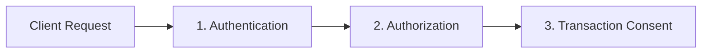

The essay is one of the most resilient intellectual forms. From Michel de Montaigne to modern technical essayists, its strength has always rested on a single architectural invariant: **the continuous reading flow**. A sustained argument unfolds as an unbroken, contemplative thread of prose. The typography remains quiet, the margins remain predictable, and the authorial voice carries the reader through an evolving sequence of ideas.

It is no accident that Markdown became the lingua franca of writing on the modern web. John Gruber's CommonMark syntax succeeded because it was designed to disappear. For linear essays composed of prose paragraphs, blockquotes, code blocks, and ordered lists, Markdown provides a distraction-free medium that maps directly to clean, semantic HTML.

Yet the moment you attempt serious technical and architectural writing, this peaceful linear medium collides with a formidable tension.

---

## The tension: prose versus complex technical models

In software engineering, distributed systems, and protocol design, deep ideas cannot always be flattened into a single linear column of text. As an author, I inevitably encounter systems that demand spatial and structural expression:

1. **Multidimensional trade-off matrices**: A five-column architectural comparison evaluating consensus models, trust anchors, transaction costs, and cryptographic failure modes suffocates when squeezed into a standard reading column. Forced into a cramped width, table cells wrap frantically, headings collide, and the comparative clarity of the matrix is lost.
2. **Topological and sequence diagrams**: A multi-step asynchronous protocol between clients, edge coordinators, and backend validators requires spatial breadth. When shrunk down to fit standard text margins, complex architectural diagrams become unreadable postage stamps.
3. **Living models and dynamic simulations (complex interaction)**: Dynamic systems—such as token-bucket rate limiters under burst traffic, distributed quorum failovers, or the autonomous agent flocking field running on this site's home page—eventually encounter an epistemological limit in static prose. Metaphor and static diagrams can take comprehension only so far. At a certain threshold of complexity, true understanding demands that the reader manipulate variables, stress-test boundaries, and observe state transitions in real time.

When technical writers encounter this tension on the web, modern publishing platforms typically capitulate in one of three flawed ways:

### 1. The application trap (MDX and framework coupling)
The dominant trend across modern developer blogs is to abandon plain text and adopt **MDX**, embedding interactive JSX or Vue components directly into the document. 

This approach conflates an essay with a software application. An essay is no longer an archival, durable text document; it is source code tied to a specific JavaScript UI framework, build bundler, and hydration pipeline. In five years, when the bundler API changes, the JSX runtime updates, or the component library is abandoned, the essay will fail to build. More damagingly, authoring prose inside JSX destroys writerly concentration, transforming the act of writing into an exercise in front-end component plumbing.

### 2. The documentation trap (the appliance manual and "box soup")
Other platforms retain Markdown but import the visual conventions of cloud reference documentation. Authors sprinkle raw `<div>` tags with dozens of utility classes across their text, wrapping every other paragraph in colorful alert boxes and flashing badges labeled `NOTE`, `TIP`, or `IMPORTANT`.

This shatters the authorial voice. The reader is treated not as a thinker exploring an argument, but as a hurried operator following an appliance repair checklist. The contemplative rhythm of the essay is replaced by visual noise.

### 3. The purist retreat (the flat document)
At the opposite extreme, Markdown purists refuse all rich layouts and interactive mechanisms. Wide matrices are forced into horizontal overflow scrollers that hide two-thirds of their columns, complex diagrams are replaced by clumsy ASCII approximations or external links, and dynamic simulations are described in passive abstractions. The reading flow is nominally preserved, but at the cost of intellectual fidelity.

---

## The architectural resolution

Building this site meant refusing to choose between the serene durability of the essay and the expressive power of rich diagrams and interactive simulations.

To resolve this tension in this artifact, I established three core architectural commitments:
1. **Reading flow as the primary invariant**: Layout breakouts and visual shifts must act as *cognitive punctuation* that respects the eye's scanning line, rather than arbitrary visual decoration.
2. **Quiet semantic extensions**: Rich layouts and diagrams must emerge from existing metadata seams in CommonMark (URL fragments and fence headers), preserving plain-text readability, RSS compatibility, and zero-dependency compilation.
3. **Progressive enhancement as epistemic truth**: Every interactive widget must have a complete, authentic static reality that delivers the entire argument without requiring a single byte of client JavaScript.

```mermaid#wide Resolving the architectural tension between prose and interaction.
flowchart LR
    subgraph INPUT["Plain Markdown Source"]
        PROSE[Linear Prose Column]
        SEAM1[URL Fragment Hints]
        SEAM2[Container Directives]
    end

    subgraph ENGINE["Deterministic Compiler"]
        VAL[Schema & AST Validation]
        SEM[Semantic HTML5 Emission]
    end

    subgraph OUTPUT["Dual-Reality Presentation"]
        direction TB
        LEVEL0["Level 0: Archival & Zero-JS\n(Full prose scale, semantic tables, inline SVG)"]
        LEVEL1["Level 1: Living Apparatus\n(Progressive client hydration, interactive canvases)"]
    end

    INPUT --> ENGINE
    ENGINE --> OUTPUT
```

---

## Principle 1: Reading flow as the primary invariant

In long-form writing, **reading flow** is not merely an aesthetic preference; it is the cognitive foundation of comprehension. When a reader is engaged in a complex argument, their working memory builds an internal model of the problem space. The moment the eye trips over an unannounced layout shift, a jarring jump in font size, or an aggressive border, that mental stack is disrupted.

### The prose spine
In this artifact, the foundation is the **prose spine**: a disciplined reading measure set in serif type with generous optical leading. It creates a comfortable, natural horizontal eye sweep that minimizes ocular fatigue across several thousand words without feeling cramped or sprawling.

### Breakouts as cognitive punctuation
When an architectural diagram or comparison table needs more space, it should not arbitrarily float or crowd the text. Instead, it executes an intentional, symmetrical **breakout**:

- **Wide breakout** (`wide`): The element expands symmetrically beyond the prose spine to align flush with the outer grid boundary, giving dense comparison matrices and system topologies the horizontal breathing room they require.
- **Full bleed** (`bleed`): For expansive system panoramas, the element extends edge-to-edge across the display, while its explanatory caption remains anchored to the central reading column.
- **Narrow focus** (`narrow`): For mobile mockups, state machines, or focused dialog snapshots, the figure is centered and tightly bounded, preventing small diagrams from ballooning into awkward empty space.

Crucially, these breakouts act as **cognitive punctuation**. Expanding to a wider measure gives the reader visual breathing room to absorb a high-density model. Once the diagram or matrix is absorbed, the reader’s gaze effortlessly returns to the main reading line without any disorienting visual compensation.

### Optical continuum across asides
A frequent flaw in technical publishing is demoting notes, historical context, or caveats into tiny fine print. This forces the reader’s eye muscles to constantly adjust between the main text and ancillary callouts.

On this site, I ensure that ancillary callouts and containers inherit the **full prose typographic scale and line rhythm**. The aside reads as a natural vocal modulation of the essay's narrator, maintaining an uninterrupted optical continuum.

---

## Principle 2: Quiet semantic extensions

When designing this artifact, my question was straightforward: How can I give myself full layout control over responsive figures, tables, and diagrams without littering Markdown with framework-specific syntax or raw HTML?

The architectural principle is simple: **Anchor layout intent to existing semantic seams in CommonMark.**

### Seam 1: Identifiers and URL fragments for atomic elements
In CommonMark, atomic elements like images and code fences already possess dedicated syntactic slots for metadata: the destination URL and the info string.

Instead of wrapping an image in an ad-hoc container, layout intent is expressed as a standard URL hash fragment:

```markdown

```

The fragment `#wide` is a quiet semantic declaration. At build time, this site's static compiler parses the fragment, validates it against a strict allowlist (`#wide`, `#bleed`, `#narrow`, `#float-left`, `#float-right`), and strips it from the final `src` attribute. It then emits clean, accessible HTML5:

```html
<figure class="image-figure image-wide">
  
  <figcaption>Figure 1: The staged execution pipeline.</figcaption>
</figure>
```

In a terminal pager, a headless parser, or an RSS feed, the syntax remains completely valid CommonMark. There are no dangling custom tags or broken HTML entities.

The same protocol applies to architectural diagrams. Fenced code blocks provide an info string immediately following the opening backticks. I extended this seam directly to Mermaid diagrams:

````markdown

````

The compiler parses the `#wide` modifier and the caption string, generates an accessible, deterministic inline SVG, and encloses it in `<figure class="mermaid-diagram image-wide">`. Readers on desktop and touch screens automatically receive progressive pan-and-zoom modal controls, while the authoring remains pure plain text.

### Seam 2: Container fences for multi-block composite units
While images and code blocks have URLs or fence headers, Markdown tables do not. A GitHub Flavored Markdown (GFM) table begins immediately with pipe characters:

```markdown
| Pattern | Who Confirms | Trust Anchor | User Friction |
| :--- | :--- | :--- | :--- |
| **1. Staged Preparation** | User | Human presence | Low–Medium |
| **2. Threshold Envelopes** | Application Backend | Stored policy engine | Zero |
```

When I need a five-column matrix to break out beyond the standard reading measure—and need to bind an explanatory note or methodological caveat directly to that table—inline URL fragments cannot help.

For this, I adopted the standard **fenced container** syntax (`:::`), popularized by Pandoc fenced divs and the CommonMark Generic Directives proposal:

```markdown
::: wide

| Pattern | Who Confirms | Trust Anchor | User Friction | Best Suited For |
| :--- | :--- | :--- | :--- | :--- |
| **1. Staged Preparation** | User | Human presence | Low–Medium | High-value actions |
| **2. Threshold Envelopes** | Application Backend | Stored policy engine | Zero | Routine consumer actions |
| **3. Capability Tokens** | Authorized Delegate | OAuth RAR / RFC 9396 | Low | Cross-origin ecosystems |
| **4. Cryptographic Binding** | User or Delegate | Asymmetric cryptography | Medium | High-assurance finance |

*(Note: Technical authorization is often paired with operational risk backstops, such as velocity limits and temporary holds.)*

:::
```

Notice what this achieves:
1. **Semantic HTML5 landmarks**: The container compiles to `<figure class="component component-wide">` rather than generic `<div>` soup.
2. **Composite editorial units**: The wide table and its italicized note form a single, coherent figure. When viewed on wide screens, they break out together as a unified editorial block.
3. **Contextual scrolling without global hacks**: The compiler automatically wraps tables in `<div class="table-scroll" role="region" tabindex="0">`. On narrow viewports, the table scrolls horizontally with full keyboard accessibility. By letting the container govern the width, simpler two-column tables elsewhere across the site remain compact, avoiding heavy-handed global minimum widths.

---

## Principle 3: The living essay and complex interaction

This brings us to the highest point of tension: **interactive widgets and living systems**.

When an essay explores a non-trivial algorithm—such as token-bucket rate limiting under high-concurrency agent traffic, consensus voting thresholds, or the autonomous multi-agent flocking field running on this site's home page—passive prose can only illustrate the concept up to a certain fidelity. The reader needs to touch the parameters to verify hypotheses: *What happens when the burst allowance is exhausted? How does latency spike when quorum nodes fail?*

How do I introduce these interactive models into an essay without surrendering the artifact to the fragile client-side runtime of modern web apps?

### The epistemological guarantee: progressive enhancement
My answer is grounded in an epistemological stance: **The prose must stand on its own as complete literature.** 

An interactive simulation in an essay is an *amplification* or an *exploratory lens*, never an existential prerequisite to understanding the text. If client JavaScript is disabled, if an RSS aggregator parses the article, or if the essay is printed to PDF, the reader must still receive the complete, uncompromised argument.

I implement this through two complementary architectural patterns:

### Pattern A: The declarative specimen (data-driven widgets)
When a widget represents an interactive simulation configured by typed mathematical parameters, it is authored as a fenced code block with a clean YAML payload:

````markdown
```rate-limiter#wide Token Bucket Simulator
capacity: 100
refill_rate: 10
burst_allowance: true
```
````

During compilation:
1. The static build engine parses the YAML payload and validates it against a strict JSON schema. Typos or missing parameters fail the build immediately.
2. The engine emits a semantic HTML5 figure with declarative data attributes:
   ```html
   <figure class="component component-wide" data-widget="rate-limiter" data-props='{"capacity":100,"refill_rate":10,"burst_allowance":true}'>
     <div class="widget-mount">
       <!-- Static fallback representation -->
       <p class="widget-fallback">Capacity: 100 tokens · Refill: 10 tokens/sec · Burst: Enabled</p>
     </div>
     <figcaption>Token Bucket Simulator</figcaption>
   </figure>
   ```
3. In a static environment, the reader sees an exact, elegant ledger of the parameters. In an active browser, a lightweight client module attaches unobtrusively to the mount point, rendering interactive sliders, step-debuggers, and canvas visualizations.

### Pattern B: The semantic fallback (content-driven widgets)
When an interactive model can express its initial state through human-readable tables or prose, I use container fences:

```markdown
::: rate-limiter wide

| Parameter | Initial Value | Range | Step |
| :--- | :--- | :--- | :--- |
| Bucket Capacity | 100 tokens | 10 – 500 | 10 |
| Refill Rate | 10 tokens/sec | 1 – 50 | 1 |
| Initial Burst | 50 tokens | 0 – 100 | 5 |

*(Drag sliders to test token exhaustion under concurrent agent requests.)*

:::
```

This represents the purest expression of progressive enhancement:
- **Zero-JS and Feed Readers**: The reader receives a clean, accessible, beautifully formatted table. The document is completely legible and archival.
- **Enhanced Browser**: The client script reads the table cells as its initial state, gracefully docks the raw table, and injects interactive reactive controls and live simulation canvases.

The author writes standard Markdown. The reader gains a responsive, living simulation. The document remains durable for decades.

---

## Principle 4: Restraint and the essayistic voice

The greatest threat to reading flow is not technical limitation; it is **lack of editorial restraint**.

In standard technical documentation, authors are encouraged to box off every third paragraph. Every installation command is surrounded by badges, icons, and cautionary colors. This visual hyperactivity stems from a fundamental misunderstanding of the difference between an *operational reference manual* and an *architectural essay*:

- In a **reference manual**, the reader is skimming frantically to locate a configuration key or avoid a syntax error. Loud badges and traffic-light colors serve an operational checklist function.
- In an **architectural essay**, the reader is engaged in reflective inquiry. Shouting badges and constant boxed interruptions patronize the reader and fragment the narrative continuum.

To preserve the authorial voice, I applied strict architectural discipline to callouts and asides across this site:

### 1. Title-less asides by default
Most documentation generators automatically prepend an all-caps title like `NOTE` or `IMPORTANT` to every callout box. In reflective writing, this destroys the tone.

In this site's compiler, containers are **title-less by default**:

```markdown
::: important
Safe and idempotent does not mean identical answers, zero incidental effects, or exactly-once execution.
:::
```

This compiles without a corporate banner, yielding a quiet, bordered aside that flows seamlessly with the surrounding prose:

```html
<aside class="callout callout-important" role="note">
  <p>Safe and idempotent does not mean identical answers...</p>
</aside>
```

When an aside genuinely benefits from structural framing, I provide an explicit **editorial micro-headline** (e.g. `::: warning Cascading retry storms in gossip protocols`), which renders the specific conceptual headline rather than a bureaucratic label.

### 2. Strict two-tone palette discipline (no SaaS rainbow)
Standard documentation themes borrow the entire Tailwind palette: emerald green for tips, sapphire blue for notes, amber orange for warnings, and violet for info. When mixed with an essay's typographic theme, this creates an uncoordinated "traffic light" effect that screams for attention.

I restricted all callouts on this site strictly to two foundational semantic tokens:
- **Informational tiers** (`note`, `info`, `tip`): Rendered in the site's muted ink (warm roasted coffee slate in light mode, misty rose-slate in dark mode).
- **Critical & Actionable tiers** (`important`, `warning`, `caution`): Rendered in the primary accent (authoritative Bordeaux ruby in light mode, electric crimson in dark mode).

Visual differentiation is carried by typography, semantic SVG icons, and authorial headlines—never by a distracting rainbow of background fills.

### 3. Beyond the box: paragraph run-in glyphs
Why must every caveat or technical invariant be enclosed inside a bordered rectangular box?

In fine book typography (from Aldus Manutius to Edward Tufte), classical printers avoided drawing heavy colored frames around text. Instead, they signaled turns in an argument or subtle caveats using elegant **run-in glyphs** (pilcrows, fleurons, or subtle geometric marks) placed directly at the head of a paragraph.

As a planned enhancement to this site's engine, I am introducing **Paragraph Run-In Glyphs**:

```markdown
::glyph warning *Safe and idempotent does not mean identical answers.* We are issuing a complete, new HTTP exchange to recover from a lost message at the application layer...
```

This compiles into an inline lead paragraph:

```html
<p class="glyph-lead glyph-warning">
  <span class="glyph-mark" aria-hidden="true">
    <svg viewBox="0 0 16 16" fill="currentColor">...</svg>
  </span>
  <em>Safe and idempotent does not mean identical answers.</em> We are issuing...
</p>
```

- No heavy background fill.
- No disruptive vertical border rules.
- No vertical padding interruptions.
- The text remains seamlessly part of the continuous prose column.

The reader receives a subtle visual landmark without ever being forced to step outside the reading flow.

---

## Architectural lessons for the decennial web

Extending Markdown to accommodate complex technical essays without corrupting it requires clear architectural discipline:

1. **The prose spine is sovereign**: If an essay’s thesis cannot stand as a coherent, insightful piece of literature in plain text, no amount of layout acrobatics or interactive widgetry will redeem it.
2. **Decouple prose from client runtimes**: Never allow an essay's authoring source to depend on a JavaScript UI framework or bundler. Plain text is the only medium that outlives the churn of front-end ecosystems.
3. **Extensions belong in existing semantic seams**: Leverage URL fragments, info strings, and container landmarks rather than inventing ad-hoc syntax or sprinkling raw HTML.
4. **Progressive enhancement as an epistemological guarantee**: Every interactive model must possess an authentic static fallback that preserves the complete argument in feed readers, terminal pagers, and archival print.
5. **Layout breakouts are cognitive punctuation**: Symmetrical expansions provide spatial breathing room for high-density models, then seamlessly release the eye back to the reading line.

By pairing quiet semantic conventions with strict compile-time validation and progressive enhancement, this artifact resolves the tension between the essay and the apparatus. Markdown remains what it was always meant to be: an enduring, joyful medium for deep human thought.
