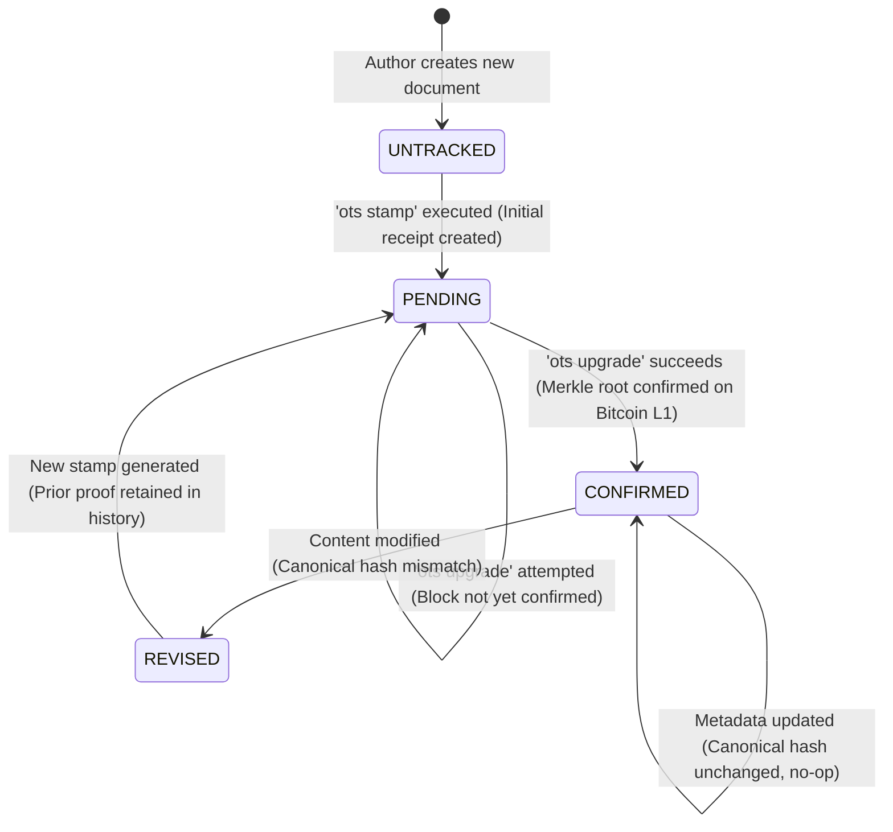
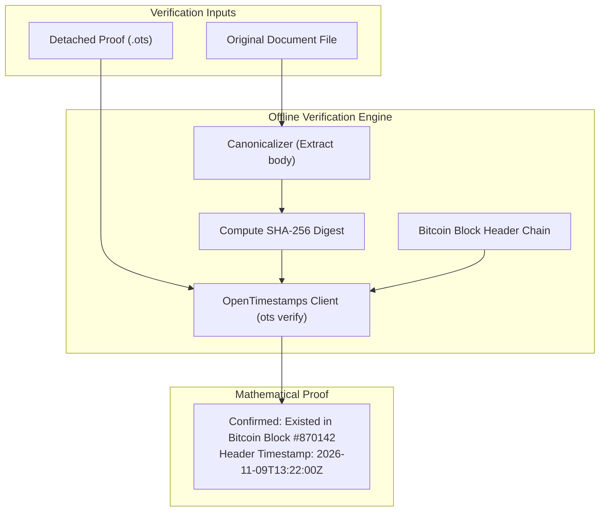

In the first part of this series (*Proving existence and authorship*), we established the theoretical principles of decentralized timestamps: decoupling author identity from crypto wallets via digital signatures, and anchoring document hashes into the Bitcoin blockchain using OpenTimestamps (OTS) Merkle aggregation.

Moving from cryptographic theory to a functioning software pipeline, however, exposes a fundamental systems engineering challenge: **an impedance mismatch in time**.

Modern build tools, compilation scripts, and continuous deployment systems run in seconds. They are designed to be fast, deterministic, and repeatable. In contrast, distributed blockchain consensus is fundamentally asynchronous: public calendar servers aggregate Merkle trees over several hours, and Bitcoin block confirmations arrive at variable intervals governed by Poisson processes.

If you attempt to bridge these two systems naively, your build process will quickly suffer from hanging pipelines, non-deterministic outputs, and brittle cryptographic proofs.

While the principles explored here apply to any automated document pipeline—such as software release digests, legal document workflows, or regulatory archives—this article uses a static website generator as a concrete, end-to-end case study. We examine how to build an automated, zero-cost stamping pipeline that maintains clean separation of concerns.

---

## The CI/CD anti-pattern

When automating timestamp generation, a common initial instinct is to insert the stamping command directly into a continuous integration (CI/CD) deployment pipeline:

```mermaid#wide The CI/CD anti-pattern versus decoupled local state tracking.
flowchart TD
    subgraph BAD["Anti-Pattern: In-Pipeline Blockchain Stamping"]
        direction TB
        GIT_PUSH["Push Commit to Main"] --> CI["CI Runner Starts"]
        CI --> BUILD_STEP["Compile Artifacts / Pages"]
        BUILD_STEP --> OTS_WAIT["Execute 'ots stamp' in CI"]
        OTS_WAIT -.->|Waiting for Calendar & Bitcoin (2 to 6 hours)| TIMEOUT["❌ CI Timeout / Flaky Build Failure"]
    end

    subgraph GOOD["The Correct Architecture: Decoupled Out-of-Band Stamping"]
        direction TB
        LOCAL_AUTHOR["Authoring / Modification"] --> LOCAL_STAMP["Local Stamp Cycle (Instant Pending Receipt)"]
        LOCAL_STAMP --> COMMIT["Commit Source + .ots Proof + Manifest"]
        COMMIT --> REPO["Push to Central Repository"]
        REPO --> PURE_CI["Deterministic Read-Only CI Build (Seconds)"]
        PURE_CI --> DEPLOY["Instant Deployment"]
    end
```

Running stamping operations inside CI/CD creates three severe failure modes:

1. **The latency trap**: When a file is stamped (`ots stamp document.txt`), the calendar server returns an *incomplete* proof receipt within seconds. However, that proof is not fully anchored until the calendar's Merkle root is mined into a Bitcoin block—a process that takes between two and six hours. A build runner cannot hang indefinitely waiting for L1 settlement.
2. **Network dependencies and rate limits**: Calling external calendar servers during every CI execution introduces external network dependencies into what should be an isolated compilation step. Temporary network partitions or calendar server rate limits will cause deployment builds to fail intermittently.
3. **Loss of build determinism**: If an automated build queries an external API or injects variable blockchain timestamps during compilation, identical source commits will produce different binary outputs. This breaks reproducible builds.

The architectural rule is straightforward: **Stamping and upgrading are asynchronous, out-of-band operational cycles; the build and compilation pipeline must remain strictly synchronous, offline, and read-only.**

---

## The canonicalization trap

Before hashing any digital document, you must determine exactly *what bytes* are being stamped.

If you pass a raw file directly to a hashing function:

```bash
sha256sum content/posts/my-essay.md
```

You risk falling into **the canonicalization trap**.

In many publishing workflows, documents contain two distinct layers:
1. **Presentation metadata**: Formatting headers, publication flags, layout parameters, tags, and category taxonomy (such as YAML frontmatter).
2. **Authorial content**: The actual prose, specification, code examples, or mathematical formulas that form the substance of the work.

```mermaid#wide The canonicalization process: separating volatile metadata from invariant prose.
flowchart LR
    subgraph RAW["Raw Document File"]
        FM["---<br/>title: My Essay<br/>tags: ['tech']<br/>draft: false<br/>---"]
        BODY["# Introduction<br/><br/>The continuous reading flow..."]
    end

    subgraph ENGINE["Canonicalization Engine"]
        STRIP["1. Strip frontmatter delimiters (---...---)"]
        NORM_EOL["2. Normalize line endings (\r\n → \n)"]
        TRIM["3. Strip trailing whitespace"]
    end

    subgraph HASHES["Dual Cryptographic Outputs"]
        CANON_HASH["SHA-256 Canonical Body Hash<br/>(Immutable Temporal Anchor)"]
        META_HASH["Metadata Fingerprint<br/>(Local Cache Tracking)"]
    end

    RAW --> ENGINE
    ENGINE --> CANON_HASH
    FM --> META_HASH
```

Consider what happens if you correct a minor typo in your document metadata three months after publication—for instance, updating a category tag or fixing a typo in a description.

If you stamped the raw file, changing that single byte produces a completely different SHA-256 digest. Your existing `.ots` proof file immediately fails verification, and your cryptographic proof of existence for the original content is invalidated.

### Designing a canonicalization normalizer
To ensure that benign presentation or metadata edits do not break historical timestamps, the stamping pipeline passes source files through a deterministic normalization step before computing the digest:

1. **Metadata separation**: Strip leading YAML or JSON frontmatter blocks using an explicit boundary delimiter (`^---[\s\S]*?---\r?\n`).
2. **Line-ending normalization**: Convert all Windows Carriage Return + Line Feed pairs (`\r\n`) to standard UNIX Line Feeds (`\n`).
3. **Whitespace sanitization**: Strip trailing whitespace at the ends of lines and normalize multiple consecutive blank lines.
4. **Encoding enforcement**: Ensure all text conforms to standard UTF-8 Unicode Normalization Form C (NFC).

The output is the **canonical content payload**. This normalized string is the exact byte sequence passed to your digital signature utility and the OpenTimestamps client. You can safely reorganize site navigation, update tags, or adjust layout schemas without invalidating your Bitcoin anchor.

---

## The local manifest state machine

To bridge the gap between instant local edits and multi-hour blockchain confirmation, the repository maintains a lightweight local state machine via a JSON file: `timestamps-manifest.json`.



### The manifest schema
The manifest tracks the content hash, proof location, and confirmation status for every document:

```json
{
  "version": 1,
  "documents": {
    "system-architecture-spec": {
      "canonical_hash": "e3b0c44298fc1c149afbf4c8996fb92427ae41e4649b934ca495991b7852b855",
      "proof_file": "proofs/system-architecture-spec.ots",
      "status": "confirmed",
      "bitcoin_block": 870142,
      "stamped_at": "2026-11-09T10:14:00Z",
      "confirmed_at": "2026-11-09T13:22:00Z",
      "revisions": []
    }
  }
}
```

### The four operational states:

1. **`UNTRACKED`**: A newly authored document. The manifest has no record for this identifier.
2. **`PENDING`**: The initial stamp has been created. The file `proofs/<id>.ots` contains the calendar server's cryptographic receipt, but the Merkle root has not yet been confirmed in a Bitcoin block.
3. **`CONFIRMED`**: An upgrade operation has fetched the final Merkle branch connecting the file's hash to a confirmed Bitcoin block header. The `.ots` file is now fully self-contained and verifiable offline.
4. **`REVISED`**: When an author substantially updates the content, the canonical hash changes. The manifest preserves the old hash and `.ots` proof in an append-only `revisions` list (maintaining verifiable prior art for the original version) and transitions the new text into a fresh `PENDING` cycle.

---

## Operational workflow and tooling

Rather than burdening deployment runners, provenance is managed locally through two targeted scripts: `stamp` and `upgrade`.

### 1. The stamping cycle
Before committing a new or revised document, run the local stamp script:

```bash
node scripts/provenance/stamp.mjs content/posts/my-spec.md
```

The script executes the following deterministic steps:
1. Reads the source file and extracts the canonical content body.
2. Generates the SHA-256 digest of the canonical body.
3. Inspects `timestamps-manifest.json`:
   - If the hash matches an existing `CONFIRMED` record, it reports that the document is already anchored and exits without network calls.
   - If the hash is new or modified, it calls the OpenTimestamps CLI:
     ```bash
     ots stamp --output proofs/my-spec.ots <canonical_stream>
     ```
4. Records the state as `PENDING` in the manifest with the current timestamp.

### 2. The upgrade cycle
A few hours later—or via a scheduled local task—run the upgrade command:

```bash
ots upgrade proofs/*.ots
```

The OpenTimestamps client contacts the calendar servers, checks whether the aggregated Merkle root has been included in a mined Bitcoin block, and serializes the complete Merkle path back into the `.ots` file.

The script then extracts the confirmed Bitcoin block height and updates the manifest status to `CONFIRMED`.

```bash
git add content/ proofs/ timestamps-manifest.json
git commit -m "docs: anchor architecture spec to Bitcoin block #870142"
```

---

## Repository hygiene and storage footprint

A practical concern when incorporating cryptographic proofs into software repositories is **repository bloat**. Many decentralized implementations store bulky transaction receipts, binary blocks, or runtime dependencies that inflate repository size over time.

OpenTimestamps avoids this entirely:

* **Detached proof storage**: Proof receipts live in a separate `proofs/` directory rather than being concatenated into source files.
* **Microscopic storage footprint**: A finalized `.ots` proof file is approximately **400 to 700 bytes** in size. Stamping an entire library of 1,000 comprehensive specifications or essays adds less than **600 kilobytes** of binary data to your repository—smaller than a single uncompressed screenshot.
* **Git attributes**: To prevent Git from modifying line endings inside binary proof files, declare them in `.gitattributes`:
  ```gitattributes
  proofs/*.ots binary
  ```

---

## The verification protocol

The defining strength of this architecture is that verification is completely self-contained. Anyone can verify the anteriority and authenticity of a document without an account, without an API key, and without contacting any third-party service.



### Reproducible verification steps
To audit a stamped document independently:

```bash
# 1. Obtain the document and the detached proof
curl -sO https://giovannifilardo.com/content/posts/system-architecture-spec.md
curl -sO https://giovannifilardo.com/proofs/system-architecture-spec.ots

# 2. Extract the canonical payload (strip frontmatter)
node -e '
  const fs = require("fs");
  const raw = fs.readFileSync("system-architecture-spec.md", "utf8");
  const body = raw.replace(/^---[\s\S]*?---\r?\n/, "").replace(/\r\n/g, "\n").trim();
  fs.writeFileSync("canonical.txt", body);
'

# 3. Verify against the Bitcoin blockchain
ots verify system-architecture-spec.ots -f canonical.txt
```

If the verification succeeds, the OpenTimestamps client traverses the Merkle path embedded in the `.ots` file, matches the computed root against a confirmed Bitcoin block header, and outputs the exact block height and timestamp.

The auditor does not need to trust the author, the host web server, or any commercial certificate authority. The proof is mathematically self-evident, anchored to the energy and consensus of the Bitcoin network.

---

## Conclusion

By treating decentralized timestamps as generic cryptographic anchors, we achieve a reliable, low-overhead method for proving digital priority:

1. **Decouple authorship from financial transactions**: Use asymmetric key signatures to prove identity without managing cryptocurrency wallets or paying gas fees.
2. **Isolate build systems from asynchronous latency**: Handle stamping and upgrading as out-of-band operational cycles, keeping build pipelines deterministic, fast, and offline.
3. **Normalize content before hashing**: Separate volatile metadata from invariant text so that formatting and taxonomy adjustments do not invalidate historical proofs.
4. **Enable trustless verification**: Provide detached proofs that any third party can verify independently using open-source tools.
