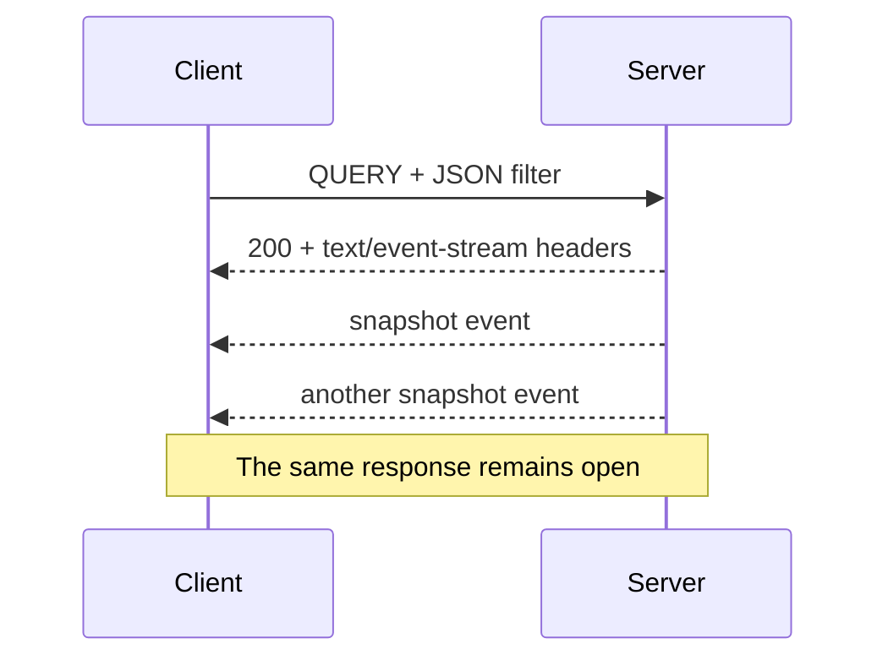

Our product search works. A JSON filter goes in, a list of matching products comes back. Then a price changes, and the list on the screen is already out of date.

Polling would be one answer. Another would be to keep the response open and send new results as they become available. Could the same `QUERY` request start that conversation?

[The first article](/posts/http-query-can-i-just-use-it/) followed a request through the stack to discover what “supports QUERY” actually means. Streaming gives us another version of that question. This time, the distinction begins inside the browser.

## SSE and EventSource are not quite the same thing

Server-sent events, or SSE, provide a text format for delivering events. EventSource is the browser API that makes receiving them convenient. They are closely associated, which makes it easy to assume that choosing one means choosing the other.

The native [EventSource interface](https://html.spec.whatwg.org/multipage/server-sent-events.html#the-eventsource-interface) starts a `GET` request. Its constructor accepts a URL and an option for credentials, but no method, request body, or arbitrary headers. So this cannot simply become our JSON-filtered `QUERY` request:

```js
const events = new EventSource('/products/live');
```

That is a restriction of this API. It does not mean a server must reject every other method before returning an event stream.

The architectural inference is straightforward: a `QUERY` endpoint can return `text/event-stream`, provided the operation still honors its safe, idempotent contract. Keeping a read open does not inherently turn it into a write. Creating a durable subscription with its own lifecycle, billing, or externally visible state would be a separate operation to design, rather than something hidden inside the read.

Fetch gives us the method and body controls we need. What it does not give us is all of EventSource's behavior for free.

## One response, several events

An SSE response has a `Content-Type` of `text/event-stream`. A small event might look like this:

```text
event: snapshot
data: {"matches":[{"id":1,"price":18}]}

```

The blank line ends the event. The `event` field names its type; `data` carries text that our application happens to interpret as JSON. SSE itself does not require JSON.

More events follow in the same response body. The server is not sending another HTTP status line and another set of response headers each time.



There is also a distinction between an HTTP response and a network connection. Under HTTP/1.1, a long-running response occupies that connection while it is being delivered. HTTP/2 can carry [multiple concurrent streams on one connection](https://www.rfc-editor.org/rfc/rfc9113.html#section-5). Opening another event stream therefore does not necessarily mean opening another TCP connection. It still consumes resources at the browser, edge, and application.

## A small stream we can inspect

Here is a standalone example using Node.js 24 and Express 5.3.0, as in part one. In a scratch project with `npm install express@5.3.0`, it can be saved as `server.mjs` and started with `node server.mjs`.

It simulates three catalogue snapshots, one second apart. The book moves above our price limit and then back below it. These are scripted values, not a database change feed; restarting the request starts the demonstration again.

```js
import express from 'express';

const app = express();
app.use(express.json({ limit: '16kb' }));

app.query('/products/live', (req, res) => {
  const { category, maxPrice } = req.body ?? {};
  if (typeof category !== 'string' ||
      typeof maxPrice !== 'number' ||
      !Number.isFinite(maxPrice) || maxPrice < 0) {
    return res.status(400).json({ error: 'Expected category and maxPrice' });
  }

  res.set({
    'Content-Type': 'text/event-stream; charset=utf-8',
    'Cache-Control': 'no-store',
  });
  res.flushHeaders();

  const prices = [18, 28, 22];
  let index = 0;
  let timer;
  res.once('close', () => clearInterval(timer));

  timer = setInterval(() => {
    const products = [
      { id: 1, category: 'books', price: prices[index] },
      { id: 2, category: 'games', price: 24 },
    ];
    const matches = products.filter(product =>
      product.category === category && product.price <= maxPrice
    );
    const data = JSON.stringify({ matches });
    const accepted = res.write(`event: snapshot\ndata: ${data}\n\n`);
    index += 1;

    // This tiny example disconnects slow consumers instead of queuing more data.
    if (!accepted) {
      clearInterval(timer);
      res.destroy();
      return;
    }
    if (index === prices.length) {
      clearInterval(timer);
      res.end('event: complete\ndata: {}\n\n');
    }
  }, 1000);
});

app.listen(3000, '127.0.0.1');
```

With a books filter and a maximum price of 25, the snapshots contain the book, then an empty list, then the book again at 22. Sending complete snapshots keeps the client simple: each one replaces the previous selection. A real implementation could observe catalogue changes and reevaluate the filter instead of walking through a fixed array.

The `complete` event belongs to this example's application protocol. SSE does not assign that name any special meaning. It gives our client a way to distinguish an intentional finish from a stream that ended unexpectedly.

## Bytes need decoding; text needs parsing

A Fetch response body arrives in chunks, but those chunks are not events. One chunk may contain several events, half a line, or part of a multibyte character. Calling `JSON.parse()` on each chunk would eventually fail, even if a local test happened to work.

There are two steps here. A [streaming text decoder](https://encoding.spec.whatwg.org/#interface-textdecoderstream) turns bytes into text without losing characters split across chunks. An SSE parser then turns text into complete events. Besides blank lines, the format has rules for multiline data, comments, and line endings. A parser is a better fit than a hurried `split('\n\n')`.

This browser-module example uses [eventsource-parser](https://github.com/rexxars/eventsource-parser), installed with `npm install eventsource-parser@3` in a frontend project whose bundler resolves package imports. The frontend is assumed to serve or proxy `/products/live` on the same origin. A separate API origin would need the CORS configuration discussed in part one.

```js
import { EventSourceParserStream } from 'eventsource-parser/stream';

export async function watchProducts(url, filter, onSnapshot, signal) {
  const response = await fetch(url, {
    method: 'QUERY',
    headers: {
      'Content-Type': 'application/json',
      'Accept': 'text/event-stream',
    },
    body: JSON.stringify(filter),
    signal,
  });

  const type = response.headers.get('content-type')
    ?.split(';')[0].trim().toLowerCase();
  if (!response.ok || type !== 'text/event-stream' || !response.body) {
    await response.body?.cancel();
    throw new Error(`Expected an event stream; received HTTP ${response.status}`);
  }

  const reader = response.body
    .pipeThrough(new TextDecoderStream())
    .pipeThrough(new EventSourceParserStream())
    .getReader();

  try {
    while (true) {
      const { value: event, done } = await reader.read();
      if (done) throw new Error('Stream ended without a complete event');
      if (event.event === 'complete') return;
      if (event.event === 'snapshot') onSnapshot(JSON.parse(event.data));
    }
  } finally {
    try { await reader.cancel(); }
    finally { reader.releaseLock(); }
  }
}

const controller = new AbortController();
watchProducts(
  '/products/live',
  { category: 'books', maxPrice: 25 },
  snapshot => console.log(snapshot.matches),
  controller.signal,
).catch(error => {
  if (!controller.signal.aborted) console.error(error);
});

// When the view is no longer needed: controller.abort();
```

This deliberately handles one response. It decodes, parses, and delivers snapshots, and it releases the stream when finished or cancelled. The parser does not open requests or reconnect them. Those decisions remain outside it.

## Reconnect to what, exactly?

Now suppose the stream disconnects after the first snapshot. QUERY's idempotency permits another request, but it cannot tell the application which updates the reader missed.

With our demonstration, a new request replays the three scripted snapshots. With a real catalogue, a new request might start with the current selection. Either can be a valid read. Neither promises a continuous history.

For a product list, a fresh snapshot may be enough: the screen needs to show what matches now. For an audit feed, missing the events between two snapshots would defeat the purpose of the application.

That is the difference between **reconnecting** and **resuming**. Reconnecting establishes another response. Resuming requires an agreed position in an event history and a server that can continue from it.

Native EventSource tracks event IDs and can send `Last-Event-ID` when reconnecting. With Fetch, that bookkeeping and request header must be supplied by the client implementation. An `id` field alone does not create retained history or an acknowledgement from the application.

For example, an audit client might have applied event 41 when the connection disappears. Continuing after 41 requires the server to retain later events, interpret the cursor under the same filter and authorization, and define what happens when that cursor is too old. If events can be replayed, the consumer also needs a way to avoid applying the same change twice.

There is a further boundary around the first snapshot. If a service reads the database and only then subscribes to updates, a change between those two actions could be missed. A consistent snapshot position plus replay from that position is one possible design. QUERY and SSE do not choose that design for us.

## The stream works locally. Does it stay live through the edge?

The first article asked whether each layer would accept the method and preserve the body. A streaming response adds another question: does each layer forward data as it arrives?

A proxy can accept the entire exchange while buffering the response. The handler writes a snapshot every second, but the browser receives several at once. From the application logs, everything looks healthy. From the screen, the feature feels broken.

NGINX's [response-buffering controls](https://nginx.org/en/docs/http/ngx_http_proxy_module.html#proxy_buffering) are one concrete example. Other gateways have their own buffering and timeout settings. `Cache-Control: no-store` prevents storage by compliant caches; it is not a universal instruction to flush every intermediary's buffers. Compression middleware may introduce buffering too.

A useful integration check observes the arrival time of each event through the real public route. Time to the response headers alone cannot establish that streaming works.

Quiet periods introduce another problem. A small SSE comment can act as a heartbeat, but the interval has to fit the actual idle timeouts. A heartbeat will not override a gateway's hard maximum response duration. Some deployments will need planned reconnections even when the network is healthy.

Slow readers need a policy as well. Node's response writes expose backpressure; the example closes the stream when a write returns false, rather than accumulating an unbounded queue. A fuller implementation might pause production until the output drains. For snapshots, retaining only the newest unsent selection may be sensible; for an audit feed, silently discarding intermediate events would not be.

Long-lived reads also keep resources and access alive. Disconnects should release timers and subscriptions. Permission changes and credential expiry need an explicit policy: a login check made when the request started does not automatically reevaluate itself ten minutes later.

## Would keeping EventSource be simpler?

Quite possibly. If the filter fits comfortably in a URL, native EventSource avoids writing much of the connection-management code. Its automatic reconnection is useful, although replay still requires server support.

For larger filters, an API could accept a POST that creates a saved query or subscription, then return a URL that EventSource opens with GET. That is a different design: the saved resource needs authorization, a lifetime, and perhaps deletion. It may be a good trade if browser convenience is more valuable than keeping everything in one request. The GET URL itself need not contain the original sensitive filter, but it still needs access controls.

Fetch plus QUERY is attractive when the input belongs in a body and the client already owns its stream lifecycle. It offers control over method, headers, cancellation, and reconnection. That control comes with work; a streaming parser is only one part of the client.

WebSockets enter the discussion when the interaction needs frequent messages in both directions—for example, changing subscriptions over the same channel. SSE carries server-to-client events in an HTTP response; changing our filter here means another request. A WebSocket would not remove the need to define replay, authorization, or slow-consumer behavior.

## What have we gained?

The original question was whether a body-based read could keep delivering results. It can, provided the server and the path support that exchange. The surprising obstacle is that the browser API usually associated with SSE cannot initiate our QUERY request.

Separating the pieces makes the choice easier to explain. QUERY describes the read. SSE describes the events in its response. Fetch gives the client access to that response. The application decides whether a disconnect calls for a fresh snapshot or a continuation of retained history.

For our catalogue, a fresh filtered snapshot may be exactly what the screen needs. For an audit trail, it would be only the beginning of the design. The same transport can carry both; the promise to the reader is different.
