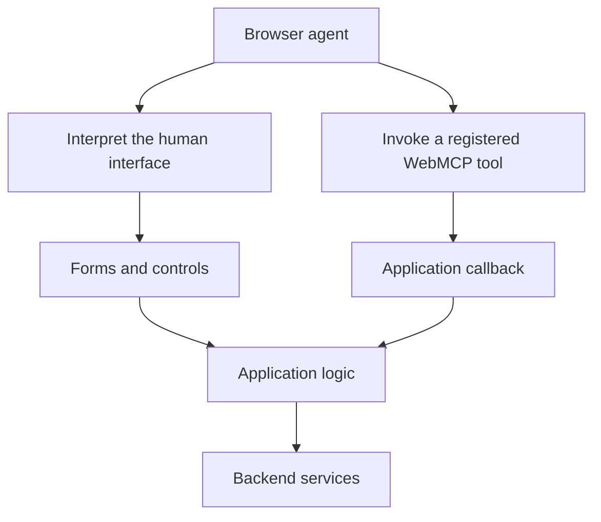

The web has an extraordinary distribution model: send someone a link, and they can open an application, sign in, and start working immediately without installing a runtime or downloading updates. The same platform serves documents, banking software, design tools, and complex business systems. That ubiquity makes the browser a natural, compelling environment for the next stage of agentic computing.

Until recently, we tended to think of agents as something added on top of a product—a conversational sidebar, an embedded support bot, or an AI search overlay. WebMCP explores a fundamentally different direction. Rather than embedding an agent inside a specific app or forcing an external agent to blindly parse visual elements, WebMCP allows an open website to expose structured capabilities directly to browser-based agents working within the user’s active session. The application itself becomes directly operable through an assistant.

## From interpreting a screen to invoking a capability



Consider a ride-booking application. A person navigates its interface intuitively through visual hierarchy: labels, maps, highlighted surge pricing banners, and interactive buttons. For an AI agent operating that same page, interpreting raw DOM elements or taking screenshots to infer which sequence of clicks books a ride is brittle, slow, and error-prone. The agent is forced to reverse-engineer developer intent from visual markup intended for human eyes.

WebMCP provides a cleaner, structured alternative. Instead of leaving an agent to guess its way through visual controls, the webpage can explicitly declare capabilities via client-side script. Using the draft's [tool definition](https://webmachinelearning.github.io/webmcp/#dictdef-modelcontexttool) and [`registerTool()`](https://webmachinelearning.github.io/webmcp/#dom-modelcontext-registertool) API, the application advertises typed tools—with names, descriptions, input schemas, and execution callbacks tied directly to frontend application logic. An agent operating within the browser discovers these tools dynamically and invokes them with structured parameters, turning visual guesswork into an explicit, deterministic contract.

## Where MCP fits
```mermaid Illustrative integration paths. WebMCP does not determine where the model runs.
flowchart TD
    A[Agent application] --> C[MCP client]
    C --> M[Local or remote MCP server]
    M --> S[Booking service]
    BA[Browser agent] --> W[WebMCP tools in an open page]
    W --> P[Web application logic]
    P --> S
```


The naming similarity invites immediate confusion, but WebMCP is neither a replacement for the Model Context Protocol (MCP) nor simply a JavaScript implementation of it. As Chrome’s [comparison of WebMCP and MCP](https://developer.chrome.com/docs/ai/webmcp/compare-mcp) points out, they operate at different layers of the architectural stack. MCP defines a protocol (typically over JSON-RPC) connecting AI clients to local or remote servers hosting external tools, prompts, and resources. It operates primarily at the service level, independent of whether a user even has a web browser open.

WebMCP, by contrast, is an in-browser API that allows an open webpage to expose capabilities running within the user's active browsing session. In our ride-booking example, a traditional MCP server might provide direct API access to the central dispatch backend for headless automations. A WebMCP tool exposes capabilities from the website currently open in a tab, inheriting the user's active session, visual state, local cookies, and ongoing interactions. Rather than competing, the two models complement each other: service-level MCP serves autonomous background pipelines, while WebMCP bridges the gap when an agent and a person are co-operating the same web application.

## An application platform with another audience

Designing for an agent audience is not merely about minimizing click counts for routine chores; it enables genuine collaborative workflows. Because WebMCP tools execute inside the live browser session, the user and the assistant can share the application state. A user can ask an assistant to research conflicting travel options, pre-fill an intricate expense claim, or configure complex software settings. Once the agent stages the work, the human can visually inspect the resulting state on screen, adjust specific fields, and finalize the outcome. The web interface remains the source of truth and the primary supervisory control plane.

This creates a compelling design challenge for product and engineering teams: identifying which capabilities become exponentially more valuable when partially delegated. The best candidates are rarely all-or-nothing automations. They are high-friction workflows that combine structured application state with nuanced user preferences—such as filtering through dozens of travel itineraries or assembling a customized merchandise order. By exposing these steps as discoverable in-page capabilities, products invite assistance without surrendering transparency.

## Enthusiasm with a clear boundary

While the architectural potential is substantial, WebMCP remains an early, emerging technology. As of late 2026, the specification is a W3C Community Group draft—not a finalized web standard. Browser support and agent runtime integration are actively evolving, and the specification itself is deliberately agnostic about where the underlying language model executes (which could be an in-browser model or a cloud-hosted agent). The most pragmatic way to experiment today is with a single, tightly bounded workflow: identify a task where users struggle with cognitive load, expose a focused set of structured capabilities, and observe how agent interaction reshapes the experience.

Yet exposing programmatic shortcuts alongside a visual interface introduces a subtle, unexpected architectural trap. When an agent can trigger backend actions without navigating the step-by-step visual journey, what happens to the warning banners, price disclosures, and explicit confirmation checkboxes carefully designed for human eyes? If the agent interface bypasses those gates, the system can commit users to outcomes they never actually approved.

In the next article, we examine the slippery slope between helpful agent shortcuts and compromised user intent—and how to architect efficiency that genuinely respects informed consent

## An accompanying example

A [working ride-booking example](https://github.com/gfilardo/gf-notebook-examples) accompanies the series. It shows a person and an agent approaching the same booking through different interfaces. The repository’s README links to the example and explains how to run it; no real booking or payment takes place.

## References and further reading

- [WebMCP specification: introduction and status](https://webmachinelearning.github.io/webmcp/#intro) — the browser-tool model and its current maturity; check the status notice before treating the API as a settled standard.
- [MCP architecture overview](https://modelcontextprotocol.io/docs/2026-07-28/learn/architecture) — primary documentation for MCP participants, discovery and execution.
- [Chrome: When to use WebMCP and MCP](https://developer.chrome.com/docs/ai/webmcp/compare-mcp) — the architectural comparison, page lifecycle and existing application context.
- [WebMCP tool dictionary](https://webmachinelearning.github.io/webmcp/#dictdef-modelcontexttool) — the actual fields behind the description of structured capabilities.
- [Chrome: WebMCP tool security](https://developer.chrome.com/docs/ai/webmcp/secure-tools) — guidance to read before exposing a consequential workflow.

*Documentation checked on 30 October 2026. WebMCP is evolving; specification text, browser implementation and agent-host behavior should be checked separately.*
