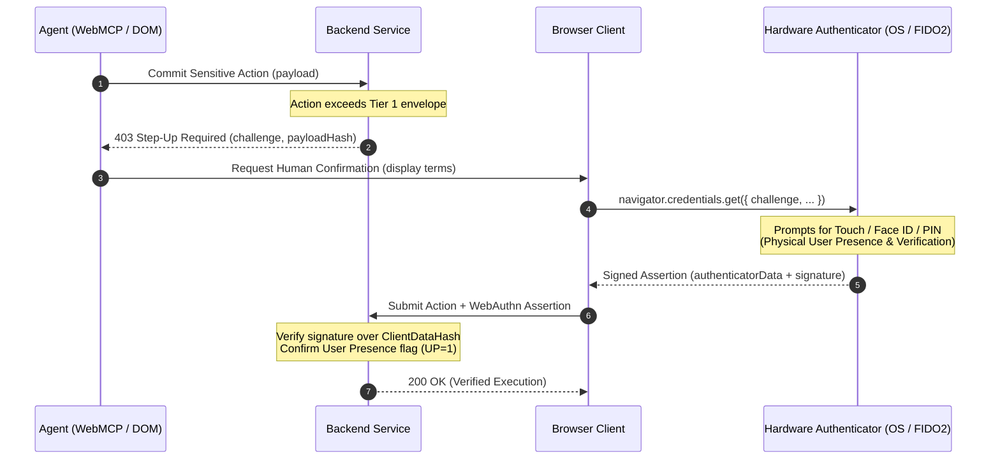

> In an agentic web, frontend interfaces can no longer be assumed to reflect human agency. Autonomous browser agents, vision-language models, and headless automation drivers manipulate the Document Object Model in ways that are indistinguishable from human browsing on the transport layer alone. Relying on heuristic origin checks creates fatal governance and liability vulnerabilities. To build robust architectures, platforms must adopt a **zero-trust UI model**: treat DOM interactions as untrusted client execution, establish an explicit liability divide through declared WebMCP tools, and anchor consequential commitments to hardware-backed, non-delegable cryptographic consent.

The earlier articles in this series addressed how to expose browser-based tools safely: recognizing [people and agents as two distinct audiences](/posts/webmcp-people-and-agents/), eliminating unintentional dark patterns when bypassing user interfaces, reasoning about delegated authority, and structuring idempotent, agent-ready transactions. 

Each of those designs rested on a critical premise: that agents interact with web applications through registered programmatic tools.

Yet in production, a stubborn reality intervenes. When an agent cannot find a declared tool—or encounters a reasoning failure, a hallucinated workflow, or an incomplete schema—it does not simply halt. It falls back to direct DOM automation: filling out input fields, clicking submit buttons, navigating checkout paths, and simulating user gestures. 

For backend services, this shatters the traditional security boundary. When an HTTP request arrives carrying a valid session cookie, how can the server know whether an action represents conscious human intent or synthetic agent autonomy?

---

## 1. The breakdown of implicit UI boundaries

The rapid adoption of agentic web standards like WebMCP introduces a structural dichotomy in web interaction:

1. **Explicit programmatic interfaces** exposed specifically for agent discovery and execution (WebMCP tools registered via `navigator.modelContext.registerTool()`).
2. **Traditional Document Object Model (DOM) frontends** designed for direct human perception, visual hierarchy, and manual manipulation.

```mermaid#wide The breakdown of implicit UI boundaries: two parallel paths into the backend.
flowchart TD
    subgraph Client["Browser Client (Shared Session & Cookies)"]
        HUMAN["Human User"] -->|Perception & Gestures| DOM["DOM Frontend (HTML / UI Elements)"]
        AGENT["Autonomous Agent"] -->|Tool Discovery| TOOLS["WebMCP Tools (JSON-RPC)"]
        AGENT -.->|Fallback / Hallucination / Bypass| DOM
    end

    DOM -->|HTTP Form / Fetch (Ambiguous Origin)| BACKEND["Backend Services"]
    TOOLS -->|Structured Tool Call (Explicit Origin)| BACKEND

    style AGENT stroke:#e06c75,stroke-dasharray: 5 5
    style DOM stroke:#e5c07b
    style TOOLS stroke:#98c379
```

Architecturally, backend services can no longer assume that HTTP traffic arriving via conventional application routes reflects human engagement. The ubiquity of headless runtimes, multimodal vision-language models (VLMs), and browser automation frameworks makes arbitrary frontend interaction indistinguishable from human browsing at the network and transport layer. A POST request triggered by a human clicking "Confirm Order" looks identical to one dispatched by a synthetic script clicking the exact same CSS selector.

This creates a fundamental governance dilemma:

* If a service provides explicit WebMCP declarations, it implicitly signals an interaction contract: agents are directed to use tool interfaces, while standard UI routes are reserved for user agency.
* However, absent legal frameworks or cryptographic barriers, agents frequently bypass explicit tools—either due to model hallucination, misconfiguration, or missing tool implementations—directly automating form fields, buttons, and checkout flows.

> [!WARNING]
> Relying on backend heuristics—such as mouse tracking, keystroke dynamics, CAPTCHAs, or browser fingerprinting—to distinguish between human users and autonomous agents is an unsustainable game of cat-and-mouse. Security architectures must treat the UI layer as an **untrusted client environment**.

---

## 2. The liability divide: declared tools vs. direct UI automation

The absence of targeted legislation for autonomous agent operations leaves liability attribution uncertain under general contract and negligence doctrines. When an agent misinterprets a prompt and purchases the wrong airline ticket, who bears the loss? The user? The agent vendor? Or the platform that processed the request?

By formalizing explicit agent interfaces, platform operators establish clear boundaries:

::: wide

| Dimension | Declared Tooling (WebMCP) | Direct UI Automation |
| :--- | :--- | :--- |
| **Interface Type** | Structured JSON-RPC / WebMCP endpoints | Arbitrary DOM event simulation |
| **Semantic Clarity** | Explicit schemas, parameter typing, and tool scopes | Implicit page state, CSS selector dependency |
| **Contractual Status** | Mutual protocol agreement | Unilateral script injection / scraping |
| **Error & Fault Attribution** | Schema validation failures, deterministic errors | Breakages caused by layout shifts or race conditions |
| **Liability Presumption** | Platform assumes responsibility for tool specification validity; agent operator assumes execution responsibility | Agent developer/operator assumes sole liability for unintended actions |

:::

Exposing explicit WebMCP endpoints functions as both a technical boundary and a terms-of-service demarcation line:

- **Inside declared tooling**: The platform guarantees interface stability, semantic contracts, and clear input validations. If the platform’s tool returns a faulty quote, the platform shares responsibility for the defective data.
- **Outside declared tooling**: When an agent deviates from declared interfaces to automate the UI directly, it forfeits the guarantees provided by platform API stability. The agent operator assumes sole liability for corrupted state, unintended transactions, or broken execution flows caused by dynamic UI changes.

To enforce this boundary technically rather than merely contractually, backend architectures require a verifiable execution model.

---

## 3. The two-tier execution model: preference envelopes vs. hardware consent

To reconcile autonomous efficiency with transaction safety, backend systems cannot force human confirmation on every single step. If every reading query or minor state change prompts the user, autonomy dies of prompt fatigue. Conversely, allowing an agent unrestricted write access invites catastrophic mistakes.

The solution is a **two-tier execution model**:

```mermaid#wide Two-tier execution architecture: preference envelopes vs. hardware-bound consent.
flowchart TD
    REQ["Agent Action Request"] --> GATE["Backend Policy Gatekeeper"]
    GATE -->|"Within preference envelope"| AUTO["Auto-Commit Execution<br/>(Tier 1: Autonomous)"]
    GATE -->|"Exceeds threshold / sensitive"| CHAL["Issue Cryptographic Challenge<br/>(Non-replayable nonce + payload hash)"]
    CHAL --> AUTH["Browser OS Authenticator Gate<br/>(WebAuthn / FIDO2)"]
    AUTH --> HW["Hardware Touch / User Presence<br/>(Biometric / Secure Enclave / Security Key)"]
    HW --> SIG["Signed Assertion to Backend<br/>(ClientDataHash + authenticator signature)"]
    SIG --> VERIF["Verified Execution<br/>(Tier 2: Hardware Consent)"]
```

### Tier 1: The autonomous preference envelope
* Governs low-risk, deterministic actions (e.g., read queries, inventory filtering, non-destructive mutations, micro-purchases under predefined budget limits).
* Executed directly via WebMCP tools under scoped session tokens.
* No human disruption required; policy constraints are evaluated automatically by backend authorization engines against stored user preferences.

### Tier 2: Cryptographic step-up consent
* Governs critical mutations (e.g., fund transfers, personal data exports, contractual sign-offs, actions exceeding preference thresholds).
* The backend refuses autonomous execution by issuing a non-replayable, cryptographically bound challenge.
* Automation cannot satisfy the challenge via DOM interaction because signing capabilities reside strictly outside the browser execution environment.

---

## 4. Hardware-bound verification: WebAuthn as the non-delegable anchor

Web Authentication ([WebAuthn / FIDO2](https://www.w3.org/TR/webauthn-2/)) provides the technological foundation for enforcing human-in-the-loop consent in an agent-dominated web. 

WebAuthn was originally designed to replace passwords with asymmetric public-key cryptography. In an agentic architecture, it serves a deeper purpose: **non-delegable proof of physical human presence and explicit intent**.

### Architectural workflow



1. **Transaction Challenge Generation:**  
   The backend generates an authentication challenge cryptographically tied to the exact transaction payload:
   
   $$\text{ClientDataHash} = H(\text{challenge} \parallel \text{origin} \parallel H(\text{TransactionPayload}))$$
   
   ```text
   ClientDataHash = SHA-256(challenge || origin || SHA-256(TransactionPayload))
   ```

2. **OS/Hardware Boundary Isolation:**  
   The browser calls `navigator.credentials.get()`. Crucially, the browser JavaScript runtime does not perform the cryptographic signing itself; it delegates execution to the underlying operating system authenticator or external hardware token (such as Apple Secure Enclave, Windows Hello, Android Keystore, or a YubiKey).

3. **Physical User Presence (UP) & Verification (UV):**  
   The authenticator requires physical user engagement—capacitive touch, biometric match (fingerprint or facial scan), or a local hardware PIN. This capability cannot be triggered through DOM synthetic events, JavaScript dispatch scripts, headless DevTools protocols, or operating system accessibility mocks.

4. **Cryptographic Assertion:**  
   The authenticator signs the challenge and transaction hash using a scoped, origin-bound private key. The assertion signature and authenticator data (containing the verified `UP` and `UV` bit flags) are transmitted back to the backend.

5. **Deterministic Backend Verification:**  
   The server validates the signature against the user's registered public key, confirming:
   - The user was physically present (`UP = 1`).
   - The user explicitly authorized the specific payload (hash match).
   - The execution path bypassed agent synthesis.

> [!IMPORTANT]
> Because the private key never leaves the hardware security module and requires physical user interaction to activate, an autonomous agent running in the browser cannot forge, simulate, or delegate this assertion—no matter how capable its reasoning engine or DOM scraping skills become.

---

## 5. Implementation architecture: zero-trust web enforcement

Enforcing this paradigm requires a coordinated stack across manifests, client APIs, and backend verification filters.

### Policy manifest (`policy-manifest.json`)

Applications can publish an explicit agent boundary policy at a well-known location (e.g., `/.well-known/webmcp-policy.json`), establishing machine-readable interaction contracts:

```json
{
  "$schema": "https://specs.webmcp.org/v1/policy-manifest.json",
  "policyVersion": "1.0.0",
  "agentBoundaries": {
    "allowedToolScopes": ["catalog:read", "cart:mutate", "checkout:prepare"],
    "prohibitedUIRoutes": ["/checkout/finalize", "/account/security"],
    "enforcement": "strict_tooling_only"
  },
  "stepUpPolicy": {
    "thresholdCurrency": "USD",
    "thresholdLimit": 50.00,
    "authMethod": "webauthn_uv_preferred"
  }
}
```

### Backend gatekeeper implementation (FastAPI / Cryptographic step-up)

The server evaluates incoming requests against the preference envelope. Routine requests execute immediately; high-consequence operations enforce cryptographic step-up consent:

```python
from fastapi import FastAPI, HTTPException, Request, Depends
import hashlib
import hmac
import secrets

app = FastAPI()

def verify_agent_envelope(action_payload: dict, user_limits: dict) -> bool:
    """Evaluate Tier 1: Is the action within autonomous bounds?"""
    amount = action_payload.get("amount", 0.0)
    return amount <= user_limits.get("max_auto_amount", 50.0)

@app.post("/api/v1/orders/commit")
async def commit_order(request: Request):
    payload = await request.json()
    action_data = payload.get("action")
    user_envelope = {"max_auto_amount": 50.0}

    # Evaluate Tier 1: Preference Envelope
    if verify_agent_envelope(action_data, user_envelope):
        return {
            "status": "SUCCESS", 
            "tier": 1, 
            "execution": "autonomous"
        }

    # Evaluate Tier 2: Enforce Cryptographic Consent
    webauthn_assertion = payload.get("webauthn_assertion")
    if not webauthn_assertion:
        # Issue non-replayable challenge tied to the exact payload hash
        challenge = secrets.token_hex(32)
        payload_hash = hashlib.sha256(str(action_data).encode("utf-8")).hexdigest()
        raise HTTPException(
            status_code=403,
            detail={
                "error": "STEP_UP_CONSENT_REQUIRED",
                "challenge": challenge,
                "payload_hash": payload_hash,
                "action": "Trigger navigator.credentials.get()"
            }
        )

    # Server-side verification of authenticator data and signature
    # (verify_webauthn_signature validates the User Presence flag and hardware signature)
    is_valid = True  # verify_webauthn_signature(webauthn_assertion, challenge)
    if not is_valid:
        raise HTTPException(
            status_code=401, 
            detail="INVALID_HARDWARE_ASSERTION"
        )

    return {
        "status": "SUCCESS", 
        "tier": 2, 
        "execution": "hardware_verified"
    }
```

---

## 6. Strategic takeaway

The future of browser security cannot rely on detecting whether a client connection is human or synthetic. Fingerprinting techniques, behavioral heuristics, and CAPTCHAs are fragile defenses against increasingly sophisticated vision-language models and native browser automation.

Platforms must embrace a zero-trust reality:

1. **Treat all UI input as potentially agent-driven.** Never assume a submitted web form represents a human decision simply because it arrived with a session cookie.
2. **Publish explicit WebMCP tools.** Define safe, structured automation boundaries to maximize agent efficiency while establishing an unmistakable contractual and legal liability line.
3. **Decouple routine actions using preference envelopes, while securing high-stakes operations behind hardware-backed WebAuthn gates.** Allow agents to handle routine tasks seamlessly, but insist on non-delegable physical presence whenever money, identity, or critical state is on the line.

---

## References and further reading

- [W3C Web Authentication (WebAuthn Level 3)](https://www.w3.org/TR/webauthn-3/) — specification for public-key credentials and user verification (`UP`/`UV`).
- [FIDO Alliance: Multi-Factor Authentication Architecture](https://fidoalliance.org/specifications/) — hardware token integration and attestation standards.
- [WebMCP Specification](https://webmachinelearning.github.io/webmcp/) — Model Context Protocol for web browsers.
- [Chrome: Secure WebMCP Tools](https://developer.chrome.com/docs/ai/webmcp/secure-tools) — security guidelines for exposing tools to in-browser agents.
- [OWASP: Transaction Authorization Cheat Sheet](https://cheatsheetseries.owasp.org/cheatsheets/Transaction_Authorization_Cheat_Sheet.html) — cryptographic binding of approval to transaction payloads.
- [OWASP: Automated Threats to Web Applications](https://owasp.org/www-project-automated-threats-to-web-applications/) — analyzing agentic and synthetic client traffic.

*Documentation checked on 2 November 2026. WebMCP and browser agent standards are actively evolving; specification drafts and platform implementations should be verified against current upstream releases.*
